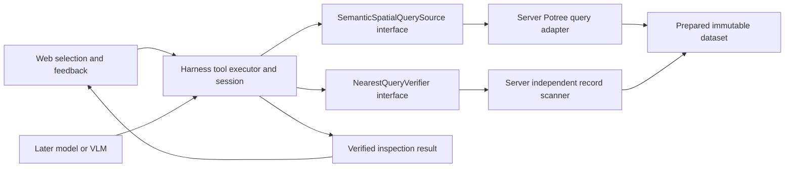

# Closest Pole-labelled point: product harness architecture

Status: **Proposed; user review pending. No runtime implementation authorized by this plan.**

Task: “Based off the Toronto3D labels, find the closest pole from a selected point.” Deliver a small read-only path from selected input through an authoritative query and independent verification to viewer feedback and reproducible evaluation. This planning checkpoint does not approve foundation/preprocessing/tasks001–004. Task005 remains resolved in its recorded bounded scope; its user browser confirmation is not automated browser evidence.

## 1. Recommended semantics

Return the **nearest stored point whose Toronto3D `scalar_Label` is 6 (Pole)**, by 3D Euclidean distance from the selected query position, across the entire prepared four-file dataset by default. Describe it to the user as “Closest Pole-labelled point (proxy for a pole).” It is an exact query of the prepared representation under the numerical rule below, not identification of an individual physical pole.

| Choice | Decision / alternative |
| --- | --- |
| Semantic target | `scalar_Label = 6`, confirmed by prepared manifest and copied/original class sidecars. Standard LAS `classification` is not this label. |
| Pole object | No instance IDs exist. Segmentation, clustering and fitting would introduce their own revisions, parameters and validation; defer them. |
| Distance | 3D XYZ distance in meters. Horizontal XY distance can give a different winner and needs a later explicit metric, not an implicit switch. Distance to an axis/base/center requires a derived pole object and is deferred. |
| Search domain | Whole prepared dataset by default. Optional explicit inclusive local AABB for fixtures/region queries; result must say “within this region.” No implicit camera, crop window, radius, source file or LOD restriction. |
| Selected point is Pole | Include it: distance zero is valid. No implicit “other pole” exclusion. |
| Ties | Compare squared distance, then numeric `(sourceFileId, sourceRow)` ascending. Coincident points with different provenance remain distinct candidates. No fuzzy tie band. |

For decoded point `p` and canonical query position `q`, compute binary64 `dx = p.x - q.x`, likewise Y/Z, then `d2 = ((dx*dx + dy*dy) + dz*dz)` in that order; return `sqrt(d2)` in meters. Equal binary64 `d2` is a tie. Version this arithmetic as `xyz-binary64-v1`, use the same explicit operation order in independent implementations, and do not rank rounded display distances. This is a reproducible numerical nearest result over stored coordinates; it does not assert infinite-precision ordering of original PLY positions. Near-equal float comparisons need adversarial fixtures before pruning is enabled.

These are reviewable recommendations, not inferred pole-instance semantics. Approval of this plan establishes them for the first implementation; changing object/metric/domain semantics changes its acceptance criteria.

## 2. Source facts and identity

Source checked at clean baseline `fb5c777`:

- [Contracts](../../packages/contracts/src/observation.ts) already carry dataset revision, coordinates, labels and provenance in observations. [Harness observation](../../packages/agent-harness/src/observation.ts) is bounded and camera-independent, with depth ≤3 and ≤4096 points. It cannot establish a global nearest point.
- [Potree adapter](../../apps/server/src/potree.ts) decodes interleaved XYZ, `scalar_Label`, `point source id` and `source_row`; `observe()` delegates to harness sampling. Its revision fingerprints metadata, manifest, first hierarchy chunk and payload size/mtime, **not all payload/hierarchy content**.
- [Full-resolution traversal](../../apps/server/src/crop.ts) follows real ancestor/descendant payloads and nested proxies, in bounded reads with cancellation/backpressure. Its public [crop events](../../packages/contracts/src/crop.ts) contain XYZ/RGB, not semantic labels or point provenance.
- [Toronto viewer](../../apps/web/src/toronto-viewer.ts) returns only Float32 render position from a pick. [Toronto UI](../../apps/web/src/Toronto.svelte) rounds that position when placing a display box. Neither currently produces an authoritative selected point reference. A pick is a raycaster-selected displayed point, not a guaranteed nearest visible surface.
- [Project state](../../packages/project-state/src/index.ts) owns editable entities and geometry revision. Toronto dataset inspection is separate; selecting/querying points does not edit a box or increment project revision. [Geometry](../../packages/geometry/src/index.ts) currently offers analytic bounds only; [agent scaffolding](../../packages/agent-harness/src/index.ts) has no model/tool/session runtime.

Prepared files checked: `data/processed/toronto3d/prepared/{manifest.json,Mavericks_classes_9.txt,octree/metadata.json}`. They describe 78,320,210 points; IDs 1–4 map to L001–L004 and `sourceRow` is the zero-based original PLY vertex row. Metadata uses local `int32 * scale + offset`, scale `[0.001,0.001,0.001]`, offset `[0.909,0.97,116.68900000000001]`. World conversion is translation only: local + `[627285,4841948,0]`, meters, right-handed Z-up; no new CRS claim.

The saved `data/processed/toronto3d/validation-report.json` reports PASS and 0.0015m/axis source-to-Potree acceptance tolerance (LAS half-step plus a Potree step); observed errors exceed 0.001m on some axes. This is earlier recorded evidence, not a validation rerun or review approval. Do not equate the 0.001m prepared scale with a 0.0005m total error to raw PLY. Query ordering uses the prepared coordinates without applying that source tolerance to distance ties.

### Selection contract and invalidation

`PointRef = (datasetId, artifactRevision, sourceFileId, sourceRow)`. GPU offsets, node indexes, screen pixels and LOD order are only disposable lookup hints, never stable IDs.

Allow two explicit inputs:

1. **Point reference:** adapter resolves the reference to its canonical prepared position. Without a provenance index, first slice uses a cancellable full scan for resolution, then a nearest scan. Reject unknown/out-of-range IDs/rows; a missing valid row is `unknown-point`, repeated provenance is corruption. Future artifact-scoped node/record locators can accelerate resolution but must be re-read and checked against the reference and revision.
2. **Coordinate:** finite local-meter binary64 triple with matching explicit frame. This allows typed positions/view targets; it makes no claim of stored-point identity. Permit points outside data bounds within the existing magnitude guard `abs(component) < 1e7`; reject unsupported units/frame and nonfinite/overflow inputs. Never silently snap coordinates to a sample. World-coordinate entry, if added, must explicitly convert through dataset coordinates before tool invocation.

Later sampled picks retain the observation's original binary64 positions and provenance alongside the disposable GPU cache. Resolve a raycaster index against that cache's generation, then send a reference; discard hits from replaced/disposed caches. Full-resolution picks require a **separate opt-in provenance extension** to bounded detail batches and per-chunk lookup caches, validated against the dataset revision. Do not enlarge or change the existing task005 stream in the first slice. Until that extension exists, a detail pick may only be explicitly labelled “coordinate query from displayed point,” or point-reference querying is unavailable there; never infer a unique source row from position proximity.

Point-reference inputs do not accept a render coordinate as authority. Canonical position comparison/re-read uses a numerical tolerance of `1e-9m` per axis on the prepared Toronto local coordinate range; that tolerance does not resolve identities or reorder candidates. A coordinate input uses its supplied value exactly under `xyz-binary64-v1`, including its display-origin approximation if applicable.

One inspection session owns dataset/frame binding, selection generation, request IDs, AbortControllers and results. Dataset revision differs from `ProjectState.revision`. Changing selection/domain/metric or dataset binding cancels the request and invalidates the current result; stale responses cannot publish. Camera or LOD changes alone preserve a resolved selection/result. A dataset revision change requires explicit reselection/rebinding rather than reinterpreting an old reference. An unrelated project box edit does not invalidate this read-only result unless it deliberately changes its query input.

## 3. Ownership and dependencies



Arrows from interfaces to implementations show runtime binding, not a package import from harness into server. Web invokes a later fixed read-only HTTP route; server composes the executor with concrete adapters. No HTTP/session wiring exists yet. Pi stays outside this diagram.

| Owner | Proposed additions |
| --- | --- |
| `@spatial/contracts` | Framework-free serializable request/result/point-reference/evidence types and runtime assertions. Dataset/frame/revision included explicitly. |
| `@spatial/agent-harness` | `SemanticSpatialQuerySource` and `NearestQueryVerifier` interfaces; deterministic tool validation/execution. Existing `PointObservationSource` remains the independent bounded observation path. No server/Pi/Three/kernel imports. |
| `apps/server` | Potree semantic-query adapter and independent verifier; bounded binary reads, label/provenance validation, revision binding and operation cleanup. Later route/transport composition. This extends existing prepared-data ownership rather than introducing a data service package. |
| `apps/web` | Session/selection controls, transport cancellation, disposable result markers/line, honest status. No query arithmetic over render buffers. |
| `@spatial/project-state`, `@spatial/geometry` | No changes for this slice. Future CAD proposals use their own entity/revision preconditions, adapter execution and postconditions. |
| `tests`, `scripts`, `artifacts/closest-pole` | Independent oracle, reproducible fixtures/integration evidence; later model evaluation separate. |

A model eventually interprets the intent, chooses an allowed query/input/domain and explains the verified response. Labels already supply the Pole class signal; nearest-distance arithmetic does not need a VLM. Make the deterministic tool executable first. Do not introduce providers, credentials, an agent loop, generic tool registry, persistence or CAD operations here.

## 4. Illustrative product contract

Names below are proposed, not current exports. `DatasetBinding` includes the existing revision, coordinate metadata and an explicit frame ID `toronto3d-local-v1`; fixture bindings use their own registered dataset ID/frame. The fixed Toronto tool maps `Pole` to the validated Toronto schema rather than accepting arbitrary label names/attributes.

```ts
type PointKey = { sourceFileId: number; sourceRow: number };
type QueryInput =
  | { kind: 'point-ref'; key: PointKey }
  | { kind: 'coordinate'; position: Vec3 };
type SearchDomain =
  | { kind: 'whole-dataset' }
  | { kind: 'aabb'; min: Vec3; max: Vec3 }; // inclusive, min < max

type NearestPoleRequest = {
  requestId: string;
  datasetId: string;
  expectedArtifactRevision: string;
  units: 'm';
  frameId: string;
  input: QueryInput;
  filter: { schema: 'toronto3d-scalar-label-v1'; attribute: 'scalar_Label'; value: 6 };
  metric: 'euclidean-3d';
  domain: SearchDomain;
};
type PointWitness = {
  key: PointKey;
  position: Vec3;
  label: 6;
  distanceSquared: number;
  distanceMeters: number;
};
type SearchEvidence = {
  artifactRevision: string;
  algorithm: 'potree-semantic-full-scan-v1'; // later a versioned pruned algorithm
  arithmetic: 'xyz-binary64-v1';
  configHash: string;
  requestHash: string;
  traversalHash: string;
  scannedPoints: number;
  matchingPoints: number; // in declared domain
  hierarchyChunks: number;
  payloadNodes: number;
  hierarchyBytes: number;
  payloadBytes: number;
  completion: 'exhausted';
};
type QueryOutcome =
  | { status: 'complete'; queryPosition: Vec3; nearest: PointWitness | null;
      evidence: SearchEvidence } // unverified adapter answer
  | { status: 'incomplete'; reason: 'cancelled' | 'resource' | 'transport';
      candidate?: PointWitness }
  | { status: 'error'; code: 'invalid-input' | 'unknown-dataset' | 'unknown-point'
      | 'stale-revision' | 'corrupt-data' | 'busy' | 'unavailable' };

interface SemanticSpatialQuerySource {
  nearestPole(request: NearestPoleRequest, signal?: AbortSignal): Promise<QueryOutcome>;
}
interface NearestQueryVerifier {
  verify(request: NearestPoleRequest, answer: Extract<QueryOutcome, {status: 'complete'}>,
    signal?: AbortSignal): Promise<VerificationOutcome>;
}
```

`VerificationOutcome` is a discriminated union: `verified` carries verifier ID `linear-record-oracle-v1`, request/revision binding, independently computed winner/null, count/coverage evidence and transcript hash; `rejected` gives mismatch details; `incomplete` gives cancellation/resource/transport reason; `error` gives stale/corrupt/unavailable diagnostics. The final tool union exposes `verified-found`, `verified-none`, `incomplete`, `error`, or `verification-rejected`. Only the first two carry `complete:true` and both search and verification evidence. Retain the full canonical request and dataset binding alongside the answer, not just hashes. Partial candidates carry `complete:false` and are never labelled closest.

Cancellation via AbortSignal is normalized to the declared incomplete outcome by the executor; unexpected exceptions become typed sanitized failures with detailed local logs. Optional progress callbacks are local execution options, not serialized request fields. They report actual counts/bytes/phase and provisional candidate with `complete:false`, with no fabricated percentage/ETA. First slice can use terminal Promise outcomes without a progress transport.

## 5. Authoritative search and verification

### First algorithm: exhaustive scan

Reuse existing safe asset opening, metadata layout/decode conventions and traversal knowledge **behind the adapter**; do not call `observe()`, compute over viewer buffers or convert `crop()` XYZ/RGB output back into labels. Add a semantic record traversal alongside the display traversal initially; factor shared traversal only if a later reviewed change proves useful. No first-slice rewrite of crop/projection/render code.

Walk the complete reachable hierarchy, including payloads in parent nodes and all descendants. A proxy points to a hierarchy chunk, not to points; follow it, validate proxy/root agreement and visit its real payload once. Validate child masks, 22-byte records, safe aligned ranges, supported encoding/stride/depth, truncated reads, cycles and overlaps. First algorithm does not prune; validate full hierarchy/payload range coverage against file size and total count before reporting exhausted. Validate finite positions, labels 0–8 and source ID/row bounds against manifest counts. The earlier one-to-one provenance audit is a prerequisite for trusted production data; count/range checks alone do not prove provenance uniqueness. Do not allocate a point-sized in-memory set to recreate that audit per request.

Read payloads in point-aligned buffers ≤4MiB and process/check cancellation/yield at ≤8192 records. Validate each record before using it, filter by exact inclusive AABB membership if present and label 6, retain only the running minimum and counters. No total point/source-byte/time cap or sample fallback. “Constant memory” means constant **point working memory**; traversal and interval-validation bookkeeping grow with hierarchy nodes/chunks. No global heap, kd-tree or point accumulator in this slice. Report hierarchy and payload bytes separately, including repeated passes; existing small metadata reads should be separately accounted for.

### Independent verifier, not a status flag

The tool executor accepts a complete adapter answer only after a second deterministic implementation confirms it. First verifier sequentially streams **every interleaved record in `octree.bin`**, independently parses the required layout/attributes, and reduces over the same declared domain/filter/numerical rule. It does not call the production query, use its hierarchy walk, share its argmin helper, or trust `completion`/hashes as proof. Independently resolve point-reference input in a preliminary linear pass when needed. Validate payload divisibility/count and compare coverage/counts with search evidence; the production full traversal must cover all payload intervals exactly once. Re-read/check the returned witness and canonical query input against provenance/label/position. Compare winner key, squared distance, distance, null result and binding, including deterministic ties.

Both paths use the same prepared artifact authority; independent computation detects traversal/decoding/ranking mistakes, not errors in Toronto annotations or adversarial replacement of trusted files. A witness re-read certifies existence/class/distance only; it cannot certify global minimality. The exhaustive second pass supplies that missing check, including the no-Pole outcome. Two or more passes cost I/O/latency; accept this for a first correctness slice and measure it before optimizing.

### Artifact binding and trust

Bind reads and both verification passes to one read-only adapter execution snapshot of opened files, layout and expected revision. Check expected revision before work and file identity/size/mtime plus metadata/root fingerprint again before final publication. Ordinary replacement/mutation becomes stale/incomplete, never verified. The current stat-based fingerprint cannot detect all in-place same-stat edits; stable immutable prepared files are an explicit deployment precondition. Do not call the fingerprint a content-integrity certificate or silently repurpose project revision.

Evaluation artifacts additionally record SHA256 of manifest, metadata, full hierarchy and full payload, plus validation-report digest and code/config versions. Stream these hashes during evidence preparation; no data regeneration. Full content digests may be cached only for an explicitly immutable artifact. Production content-addressed admission and stronger filesystem integrity are deferred; until then verification is conditional on immutable trusted artifacts, as current serving already is.

### Later alternative: conservative spatial search

Compare against the scan oracle before enabling pruning. Expanded nominal node boxes enclose payloads and descendants only under checked artifact-containment preconditions. Existing crop pruning expands by one scale step; the saved validator's containment tolerance is scale + LAS half-step. For a new search use at least that validated per-axis containment allowance, plus outward floating-point rounding, or establish a tighter independently validated bound first. Check each visited point against its expanded node box; a pruned region still relies on artifact admission evidence. Missing/stale containment evidence disables pruning and falls back to the full scan.

For expanded box `[lo, hi]`, a geometric squared lower bound is `sum(max(lo[i]-q[i], 0, q[i]-hi[i])^2)`. Implementation must produce a conservative **downward** bound including binary64 subtraction/multiplication/addition error relative to `xyz-binary64-v1`; round outward or visit on numerical ambiguity. Before a candidate exists, incumbent distance is infinity and no distance pruning is allowed. Skip a node/subtree only when the conservative lower bound is **strictly greater** than the current winning squared distance. Equality must be visited because it can change the provenance tie winner. Optional AABB-domain pruning also uses expanded boxes, with inclusive intersection; exact point membership uses unexpanded requested bounds.

Parents' stored payloads must be evaluated, not discarded as LOD. Proxy bounds belong to the referenced subtree, all required chunks must resolve, and overlapping child boundaries must not lose points. There is no per-node class histogram/minimum ID metadata today; do not use semantic pruning or tie pruning based on invented metadata. Depth-first bound checking avoids an unbounded best-first queue; ordering only affects speed, never the winner. Completion requires every relevant region visited or justified by a bound, all remaining lower bounds greater than the winner, and valid revision binding. No match requires exhaustion of all domain-relevant regions.

Retain streamed visited/pruned-region evidence (node, expanded bounds, lower bound, incumbent, payload ranges) for replay, rather than all records in RAM. A later verifier may audit that proof against admitted hierarchy/containment, but its promotion is a separate review gate. Initially keep independent linear verification, which sacrifices much of pruning's latency benefit while proving equivalence.

## 6. Execution and viewer feedback

1. Bind a known dataset/revision/frame; capture explicit coordinate or point reference in a new selection generation. Deterministic caller initially supplies the request; a later model chooses from the same contract.
2. Executor validates schema, revision, IDs, units/frame, filter/metric/domain and numeric bounds before starting. Caller controls cancellation; adapters own files and cleanup. No request can select a filesystem path.
3. Resolve point input; search all matching points. Publish only provisional progress while scanning. Preserve the request/domain independently from any display selection.
4. Verify complete answer against the same execution snapshot. Status becomes “verifying,” not “closest found.” Normalize cancellation/errors, recheck revision and generation before final publication.
5. Deliver `verified-found` or `verified-none` with canonical query position, source key, label, distance and evidence. Explain the point-proxy semantics. A model summary must reference this outcome; it cannot upgrade a candidate to verified.
6. Later UI renders the canonical query marker, a returned candidate marker independent of LOD buffers, and optionally a meter-labelled line. Offscreen poles remain valid; offer an explicit frame-result action without moving the camera automatically. Marker presence is feedback, not verification.

UI states: idle; resolving/searching; verifying; verified found; verified empty; cancelled/incomplete; failed/incomplete; stale/invalid. Visually distinguish a provisional marker from a verified marker. Clear/new selection/scene disposal releases markers and aborts that query generation. A GPU rendering failure does not falsify a completed server query: retain its verified textual result and separately report unavailable visualization. An interrupted query/verification remains incomplete even if a candidate is visible.

Later read-only route should wrap the composed executor, keep existing fixed-assets/loopback/Host/Origin/Range/input protections and shared two-operation admission with cleanup/no unbounded queue. Hold one operation slot through resolution/search/verification; reject busy requests explicitly. Transport disconnect aborts future bounded work; ignored cancellation still cannot publish into a superseded session. No instantaneous cancellation promise for active OS reads. A terminal stream message is insufficient until framing/transport validation completes, following task005's existing distinction.

Preserve task005's **uncapped cancellable progressive loading** and bounded reads/batches/backpressure/corruption safeguards. Preserve ordinary display/harness caps, algorithms, independent settings and cancellation channels. An exact semantic query is a fourth authority path, not a replacement observation LOD or a source of display downsampling. Concurrent work may be busy or slow; never alter its domain or silently cap work to return quickly.

## 7. Evaluation and evidence before model calls

Fixtures encode known source records and hierarchy layouts; the oracle derives its expectations from an independent record list/binary scan rather than query output. Perturb traversal order without changing source keys to check determinism.

| Scenario | Required evidence |
| --- | --- |
| Nearest; wrong class closer; coincident/tied poles; selected Pole itself | Expected provenance winner, correct class, d2/distance; zero allowed; provenance tie order independent of traversal. |
| No Pole, empty region, poles outside region | Verified null only after complete declared-domain traversal and independent scan. |
| Display/harness sample misses closest; pole outside camera/window | Whole-domain result unchanged across camera, display/harness LOD and crop operations. |
| Ancestor payload, descendants, nested proxies, deep nodes, large nodes | True winner reached once; full payload/count coverage; valid nodes >4MiB split, not rejected/sampled. |
| Inclusive AABB edge, quantized child edge, almost equal d2, ties in later nodes | Exact membership and fixed arithmetic; later pruning equivalence/no unsafe early termination. |
| Unknown dataset/reference, bad row, nonfinite coordinate, wrong frame/units/filter | Typed failure before an invalid query can certify. |
| Stale expected revision; replacement during search/verification; late response | No final publication under changed binding/generation. |
| Abort before work/during resolution/read/search/verification; busy/resource/transport failure | Explicit incomplete/error; handle/slot cleanup; retry possible; no nearest certification. |
| Truncation, malformed label/provenance, overlapping/cyclic ranges, missing children/proxy mismatch | Corrupt failure; no terminal certification after partial progress. |
| Forged winner/distance/label/null/count/completion | Independent verifier rejects; a matching result hash alone cannot pass. |

First actual-data check: choose one prepared Pole reference deterministically (smallest key in a recorded complete root payload; if none exists, record the complete payload searched to find one). Set coordinate input `q = canonicalPosition + [0.25,0.25,0]` and an explicit ±2.5m AABB around q, exercising a nearby query rather than only a selected-Pole zero-distance case. Run one complete production query and the independent **whole-payload linear scan filtered to that same AABB**. Compare winner/null, counts, repeated-query determinism, witness against its raw PLY source row, and independent display/harness before/after hashes. Raw position comparison uses the recorded 0.0015m/axis tolerance; raw nearest ordering is not the acceptance target. Record exact box, q, revision, source key and commands. The AABB bounds result scope; it does not guarantee low source-read work. The independent scan still reads all prepared payload records with bounded allocations, without rerunning the complete preprocessing audit. A client-aborted actual-data run is infrastructure/incomplete evidence, not a passing nearest check; report it and leave that criterion pending.

Whole-dataset correctness initially rests on complete adversarial fixtures plus exhaustive algorithm/verification, conditional on admitted artifact fidelity. This single-region actual check is not a measured whole-cloud latency/correctness audit. A later one-query whole-dataset check can reuse the linear oracle with its scope recorded explicitly.

Retain canonical request/binding, expected and actual answer, evidence/config/arithmetic/verifier IDs, repository commit + owned diff hash, Node/pnpm versions, full artifact digests, commands, logs and timings in `artifacts/closest-pole/`. Record resolution/search/verification source reads, peak bounded buffer size, hierarchy bookkeeping, cancellation latency and wall time separately; no latency claim before measuring. Keep source content and credentials out of exported logs.

After the deterministic tool is reviewed, model evaluation separately scores valid tool choice/request, correct interpretation of verified result, and refusal to claim certainty for incomplete/error outcomes. Compare exact winner to oracle, not natural-language confidence or highlight. Label infrastructure failures (busy/missing data/transport/resource) separately from tool correctness, verifier mismatch and model tool-use errors. Store model/tool configuration and inputs only when model execution is separately scoped; no provider assumption now.

## 8. Ordered implementation and first review gate

**Recommended first slice: headless full-scan query + independent verifier, invoked locally without HTTP/UI/model integration.** Accept coordinate and point-reference inputs, whole-dataset and inclusive-AABB scope; validate the Toronto Pole schema. Implement proposed contracts/interfaces, server-side semantic scan and independent linear verifier, deterministic executor and fixtures, plus one actual-data evidence script. File candidates: new `semantic-query.ts` in contracts/harness/server and verifier/test/script files, with limited adapter binding in `potree.ts`; names are illustrative. Obtain real graph impacts before each symbol edit, verify source, and report unresolved/HIGH risks rather than relying on this planning exploration.

Acceptance criteria for that slice:

- [ ] Requests bind dataset revision, meters/frame, selection kind, Pole filter, metric and explicit domain; no dependency on project geometry revision, camera or LOD.
- [ ] Complete full traversal returns the deterministic nearest stored Pole point or null; provenance resolution and record/range/count validation reject malformed input/artifacts.
- [ ] Independent linear verifier rejects altered answers, confirms global minimality within declared domain, and prevents partial/cancelled/stale answers from becoming verified.
- [ ] Point working memory/read allocations bounded; cancellation/yields and cleanup tested; no total query work/point/time cap, downsampling or first-chunk/depth-3 shortcut.
- [ ] Headless cases in the fixture matrix pass, with an independent oracle; one complete explicit-AABB actual check records exact scope, counts, digests and raw witness tolerance evidence. HTTP admission/framing/disconnection and browser interaction cases are deferred to their integration stages; adapter/executor cancellation and simulated resource/stale failures belong here.
- [ ] Existing task005 traversal/stream behavior and independent display/harness observations remain unchanged; appropriate existing regressions and `pnpm verify` pass, with exact logs. No browser passing claim for headless work.
- [ ] Actual diff inspected, task/evidence/redacted temp handoff updated, and **fresh-session review pending** until a separate review occurs.

Sequence after plan approval: (1) create an implementation task with those criteria and perform graph/source impact checks; (2) add contracts, independent fixture/oracle data and assertions; (3) implement exhaustive adapter/resolution and verifier, then composed executor; (4) run focused/regression/baseline checks and bounded actual-data evidence; (5) stop for fresh-session review. Do not bundle later stages into this slice.

Subsequent separately reviewed stages: fixed read-only HTTP/session wiring; minimal explicit point/coordinate selection and viewer feedback with browser evidence; conservative pruning only after oracle equivalence and containment/error-bound proof; then model tool-use evaluation. Pole instances/fitted axes, persistence, content-addressed admission and verified CAD edits each need their own task. The reusable principle for CAD is request preconditions → adapter execution → independent postconditions; inspection results alone authorize no mutation.

Main risks are semantic expectations about “pole,” weak current artifact fingerprint, quantization/float ordering, hierarchy corruption, long full-scan/verification latency and the cost of adding provenance to uncapped detail rendering. The chosen first slice makes each limit visible and keeps optimization/UI/model choices outside its correctness gate.

## Planning checkpoint

Completed: source-grounded semantics, identity/revision rules, module boundaries, illustrative contracts, exhaustive/pruned correctness rules, verification/evaluation design and one bounded first slice. Runtime work and implementation acceptance checks above are **not run**. No installs, data/index regeneration, commits, deployments or model/browser setup occurred. Existing review statuses remain unchanged.

Documentation checks: `git diff --no-index --check /dev/null docs/plans/2026-10-13-closest-pole-harness.md` emitted no whitespace diagnostics (exit 1 denotes the new file). Python local-link/fence check passed: 10 repository links resolve and fenced blocks are balanced. Read the full new-file content and checked final status; only `docs/plans/` is added. Exact check log: `/tmp/spatial-cad-closest-pole-plan-checks.log`. Baseline/runtime/browser tests were not rerun for this documentation-only change.

GitNexus `list_repos` bound this path to `cad-agent` (index 2026-10-11, freshness unknown). Concept `query` (including `packages`), `context(PotreeDataset)` and upstream `impact(PointObservationSource)` failed with LadybugDB read-only shadow-page recovery; callers/processes unresolved, impact **UNKNOWN**. Source reading grounds this documentation proposal, not a graph safety verdict. No existing function/class/method is edited. Next action: user reviews this plan's semantics and first slice, followed by a fresh-session plan/actual-document-diff review before runtime implementation.
